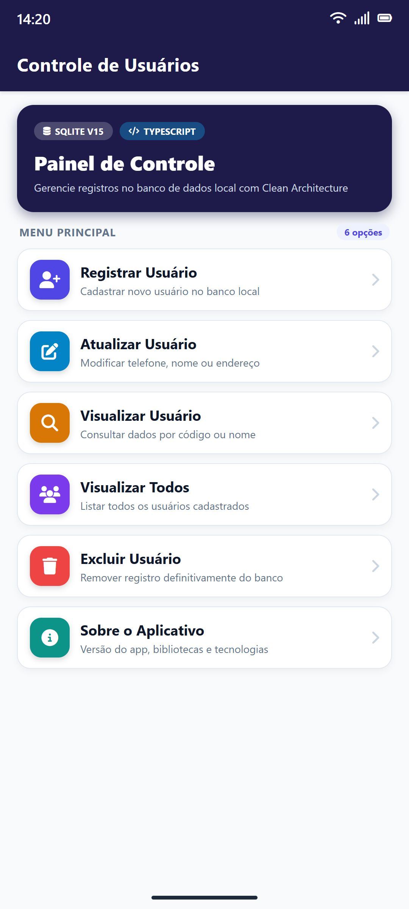
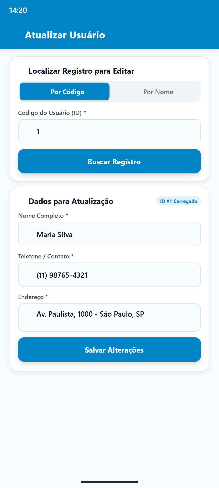
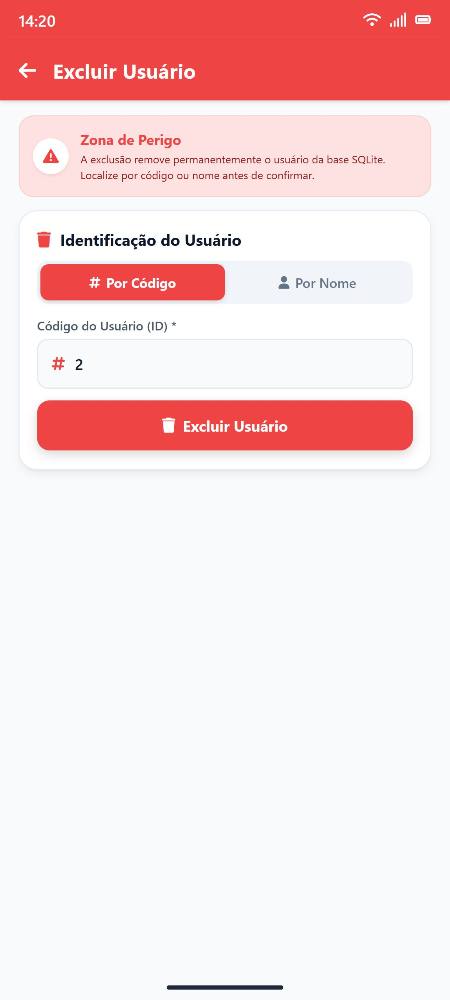
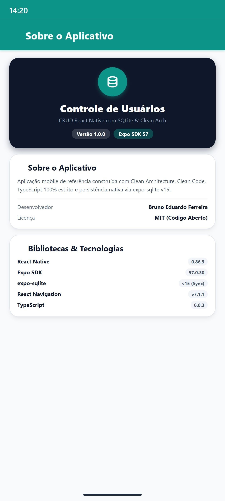
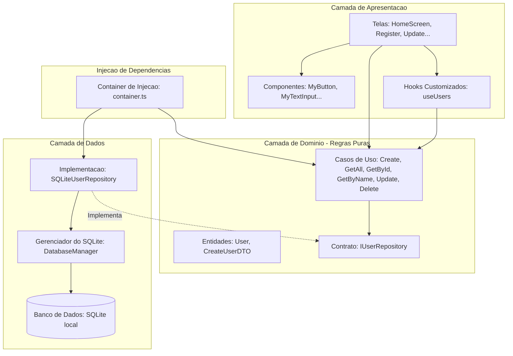

<!-- ************************************* Logo Banner ********************************************* -->
<div align="center">
  
</div>

</br>

<!-- ************************************* Título & Badges ********************************************* -->
<h1 align="center"> CRUD React Native com SQLite & Clean Architecture</h1>

<p align="center">
  
  
  
  
  
</p>

<p align="center">
  <strong>Guia educacional definitivo de desenvolvimento mobile profissional:</strong> do legado ao estado da arte com arquitetura limpa, tipagem estrita e banco de dados local de alta performance.
</p>

---

##  Sobre o Projeto

Este repositório foi concebido como um **projeto de aprendizado aprofundado**. Ele implementa um fluxo completo de **CRUD** (*Create, Read, Update, Delete*) de usuários persistido em um banco de dados **SQLite nativo e local**, executando em dispositivos móveis Android e iOS.

Originalmente construído com JavaScript e a API legada WebSQL (descontinuada), o projeto passou por uma modernização total, transformando-se em uma aplicação de referência estruturada sob os princípios de **Clean Architecture (Arquitetura Limpa)**, **Clean Code**, **TypeScript 100% estrito** e a moderna API síncrona do **`expo-sqlite` (v15)**.

---

##  Galeria de Telas da Aplicação

<div align="center">
  <table>
    <tr>
      <td align="center" width="33%">
        <strong>1. Painel de Controle (Home)</strong><br/><br/>
        
      </td>
      <td align="center" width="33%">
        <strong>2. Cadastrar Usuário</strong><br/><br/>
        
      </td>
      <td align="center" width="33%">
        <strong>3. Atualizar Dados</strong><br/><br/>
        
      </td>
    </tr>
    <tr>
      <td align="center" width="33%">
        <strong>4. Consulta (Código ou Nome)</strong><br/><br/>
        
      </td>
      <td align="center" width="33%">
        <strong>5. Base Completa & Filtro</strong><br/><br/>
        
      </td>
      <td align="center" width="33%">
        <strong>6. Exclusão com Confirmação</strong><br/><br/>
        
      </td>
    </tr>
    <tr>
      <td align="center" colspan="3">
        <strong>7. Informações do Aplicativo (Sobre)</strong><br/><br/>
        
      </td>
    </tr>
  </table>
</div>

---

##  Comparativo de Evolução Técnica

Abaixo está o resumo do salto arquitetural e tecnológico realizado no projeto:

| Aspecto | Versão Anterior (Legado) | Versão Atual (Moderna) | Benefício Educacional |
| :--- | :--- | :--- | :--- |
| **Expo SDK** | SDK 47 (Descontinuado) | **SDK 57.0.30** | Suporte às versões mais recentes do Expo Go e sistemas operacionais |
| **React Native** | 0.70.5 | **0.86.3 (New Arch padrão)** | TurboModules, Fabric Renderer e desempenho nativo de ponta |
| **Linguagem** | JavaScript (ES6) | **TypeScript 6.0 (Strict)** | Prevenção de bugs em tempo de compilação e autocomplete |
| **Arquitetura** | Código acoplado na UI | **Clean Architecture (4 camadas)** | Desacoplamento, testabilidade e regras de negócio puras |
| **Banco de Dados** | WebSQL `tx.executeSql()` (Descontinuado) | **`expo-sqlite` v15 (`openDatabaseSync`)** | Execução síncrona/direta, sem callback hell |
| **Tratamento de Erros**| `try/catch` genérico com logs soltos | **Result Pattern (`Result<T>`)** | Tratamento funcional previsível de sucesso/falha |
| **Ícones** | `react-native-vector-icons` (Link manual) | **`@expo/vector-icons`** | Integração nativa garantida sem conflito de linking |
| **Interface (UI)** | Botões básicos sem hierarquia | **Design System (Tokens & Cards)** | Cards modernos, elevação, badges e feedback visual |

---

##  Clean Architecture (Arquitetura Limpa)

A arquitetura limpa proposta por Robert C. Martin (Uncle Bob) organiza o sistema em camadas concêntricas onde **a regra de negócio é independente de frameworks, banco de dados ou interface gráfica**.



###  1. Domain (Domínio)
- **Localização:** `src/domain/`
- **Responsabilidade:** Contém as entidades e regras de negócio essenciais. É **100% TypeScript puro**, sem nenhuma importação do React Native, Expo ou SQLite.
- **Arquivos:**
  - `entities/User.ts`: Define a entidade `User`, tipos `CreateUserDTO`, `UpdateUserDTO` e a estrutura genérica `Result<T>`.
  - `repositories/IUserRepository.ts`: Define o contrato (interface) que qualquer banco de dados deve respeitar para persistir usuários.
  - `usecases/`: Contém os casos de uso unitários:
    - `CreateUserUseCase.ts`: Valida dados obrigatórios e orquestra a criação.
    - `GetAllUsersUseCase.ts`: Recupera a lista ordenada de registros.
    - `GetUserByIdUseCase.ts`: Busca e valida a existência do usuário por ID numérico.
    - `GetUserByNameUseCase.ts`: Busca flexível por nome com correspondência exata ou parcial.
    - `UpdateUserUseCase.ts`: Valida campos e persiste as modificações.
    - `DeleteUserUseCase.ts`: Garante que o registro existe antes de removê-lo.

###  2. Data (Dados)
- **Localização:** `src/data/`
- **Responsabilidade:** Implementa os detalhes técnicos de infraestrutura e persistência de dados.
- **Arquivos:**
  - `database/DatabaseManager.ts`: Gerencia o ciclo de vida do arquivo SQLite (`user_db.db`), garantindo inicialização única (Singleton) e criação da tabela com schema estrito:
    ```sql
    CREATE TABLE IF NOT EXISTS table_user (
      user_id INTEGER PRIMARY KEY AUTOINCREMENT,
      user_name TEXT NOT NULL,
      user_contact TEXT NOT NULL,
      user_address TEXT NOT NULL
    );
    ```
  - `repositories/SQLiteUserRepository.ts`: Implementa `IUserRepository`. Utiliza a API moderna do `expo-sqlite` para executar queries parametrizadas com proteção contra SQL Injection.

###  3. Presentation (Apresentação)
- **Localização:** `src/presentation/`
- **Responsabilidade:** Toda a interface do usuário, navegação, gerenciamento de estado local e feedback visual.
- **Arquivos:**
  - `theme/index.ts`: Tokens centralizados de cores (paleta Indigo/Slate), tipografia, espaçamentos e sombras com elevação nativa.
  - `components/`: Componentes atômicos reutilizáveis (`MyButton`, `MyTextInput`, `MyImageButton`, `MyText`, `SearchTypeSelector`).
  - `hooks/useUsers.ts`: Hook customizado que encapsula o estado de carregamento, erros e listagem para manter as telas limpas.
  - `screens/`: Telas funcionais (`HomeScreen`, `RegisterUserScreen`, `UpdateUserScreen`, `ViewUserScreen`, `ViewAllUserScreen`, `DeleteUserScreen`, `AboutScreen`).

###  4. DI (Injeção de Dependências)
- **Localização:** `src/di/container.ts`
- **Responsabilidade:** Instanciar as implementações de dados e injetá-las nos casos de uso. Permite trocar o banco de dados (por exemplo, de SQLite para API REST ou Mock de Testes) sem alterar uma única linha das regras de negócio ou das telas!

---

##  Como Funciona o SQLite Moderno (<code>expo-sqlite</code> v15)

Historicamente, o Expo e o React Native utilizavam o padrão **WebSQL** com transações baseadas em callbacks aninhados:

###  API Legada (WebSQL - Descontinuada)
```javascript
// Callback Hell descontinuado
db.transaction(function (tx) {
  tx.executeSql(
    'SELECT * FROM table_user',
    [],
    (tx, results) => {
      // manipulacao via results.rows.item(i)
    },
    (tx, error) => {
      console.log(error);
    }
  );
});
```

###  Nova API Síncrona / Direta (<code>expo-sqlite</code> v15)
Com a New Architecture do React Native, o `expo-sqlite` oferece métodos diretos integrados via JSI (*JavaScript Interface*), muito mais rápidos e legíveis:

```typescript
import * as SQLite from 'expo-sqlite';

// 1. Abrir ou criar o banco de dados de forma síncrona
const db = SQLite.openDatabaseSync('user_db.db');

// 2. Executar comandos de escrita (INSERT, UPDATE, DELETE)
const result = db.runSync(
  'INSERT INTO table_user (user_name, user_contact, user_address) VALUES (?, ?, ?)',
  ['Maria Silva', '11987654321', 'Av. Paulista, 1000']
);
console.log('Novo ID gerado:', result.lastInsertRowId);

// 3. Buscar uma lista de registros tipados (SELECT ALL)
const users = db.getAllSync<UserDatabaseRow>(
  'SELECT user_id, user_name, user_contact, user_address FROM table_user ORDER BY user_id DESC'
);

// 4. Buscar um único registro por chave primária (SELECT ONE)
const user = db.getFirstSync<UserDatabaseRow>(
  'SELECT user_id, user_name, user_contact, user_address FROM table_user WHERE user_id = ?',
  [1]
);
```

---

##  O Padrão <code>Result&lt;T&gt;</code>

Em vez de permitir que exceções não tratadas travem o aplicativo ou causem comportamentos imprevisíveis, todos os Casos de Uso retornam o tipo discriminado `Result<T>`:

```typescript
export type Result<T> =
  | { success: true; data: T }
  | { success: false; error: string };
```

Dessa forma, o compilador TypeScript força o desenvolvedor a verificar se a operação teve sucesso antes de acessar os dados:

```typescript
const result = await createUserUseCase.execute(userData);

if (result.success) {
  // TypeScript sabe que 'result.data' existe
  Alert.alert('Sucesso', 'Usuário cadastrado com ID ' + result.data.id);
} else {
  // TypeScript sabe que 'result.error' é uma string explicativa
  Alert.alert('Erro na operação', result.error);
}
```

---

##  Estrutura de Arquivos do Projeto

```plaintext
CRUDReactNativeSQLite/
├── App.tsx                     # Ponto de entrada com GestureHandler e SafeAreaProvider
├── app.json                    # Configurações do Expo (SDK 57, New Architecture, Splash)
├── tsconfig.json               # Configurações estritas do TypeScript
├── package.json                # Dependências atualizadas do ecossistema
├── assets/                     # Ícones, splash screen e imagens de demonstração
│   ├── icon.png                # Ícone principal do aplicativo (1024x1024)
│   ├── adaptive-icon.png       # Ícone adaptativo para Android
│   ├── splash.png              # Tela de carregamento do app
│   ├── icons/                  # Ícones vetoriais modernos em SVG para a documentação
│   └── 1.jpg ... 7.jpg         # Screenshots em alta definição das telas do aplicativo
├── images/
│   └── logo.png                # Banner estilizado do projeto
└── src/
    ├── navigation/             # Configuração do React Navigation 7
    │   ├── types.ts            # Tipos estritos de rotas e parâmetros de navegação
    │   └── AppNavigator.tsx    # Stack Navigator estilizado
    ├── domain/                 # Regras de Negócio e Domínio (TypeScript Puro)
    │   ├── entities/
    │   │   └── User.ts         # Entidade User, DTOs e Tipo Result<T>
    │   ├── repositories/
    │   │   └── IUserRepository.ts # Contrato do repositório
    │   └── usecases/           # Casos de uso específicos do CRUD
    │       ├── CreateUserUseCase.ts
    │       ├── GetAllUsersUseCase.ts
    │       ├── GetUserByIdUseCase.ts
    │       ├── GetUserByNameUseCase.ts
    │       ├── UpdateUserUseCase.ts
    │       └── DeleteUserUseCase.ts
    ├── data/                   # Implementação de Infraestrutura e Persistência
    │   ├── database/
    │   │   └── DatabaseManager.ts # Inicialização Singleton do SQLite
    │   └── repositories/
    │       └── SQLiteUserRepository.ts # Implementação concreta com SQL
    ├── di/
    │   └── container.ts        # Injeção e amarração de dependências
    └── presentation/           # Camada Visual (UI / React Native)
        ├── theme/
        │   └── index.ts        # Design tokens: paleta Indigo/Slate, espaçamentos e sombras
        ├── hooks/
        │   └── useUsers.ts     # Hook com ciclo de vida e gerenciamento de estado
        ├── components/         # Componentes atômicos reutilizáveis
        │   ├── MyButton.tsx
        │   ├── MyImageButton.tsx
        │   ├── MyTextInput.tsx
        │   ├── MyText.tsx
        │   └── SearchTypeSelector.tsx
        └── screens/            # Telas funcionais
            ├── HomeScreen.tsx
            ├── RegisterUserScreen.tsx
            ├── UpdateUserScreen.tsx
            ├── ViewUserScreen.tsx
            ├── ViewAllUserScreen.tsx
            ├── DeleteUserScreen.tsx
            └── AboutScreen.tsx
```

---

##  Como Executar o Projeto

###  Pré-requisitos
- **Node.js**: Versão LTS instalada (`v18`, `v20` ou `v24`).
- **NPM** ou **Yarn**.
- **Dispositivo Físico** com o app [Expo Go](https://expo.dev/go) instalado ou um **Emulador Android / Simulador iOS** configurado.

### 1. Clonar o Repositório
```bash
git clone https://github.com/brunoemferreira/CRUDReactNativeSQLite.git
cd CRUDReactNativeSQLite
```

### 2. Instalar as Dependências
```bash
npm install
```

### 3. Validar a Tipagem do Código (TypeScript)
O projeto conta com checagem estrita sem erros de compilação:
```bash
npm run typecheck
```

### 4. Executar no Emulador Android
Com o emulador Android aberto ou conectado via USB:
```bash
npx expo start --android
```

### 5. Executar no Simulador iOS (macOS)
```bash
npx expo start --ios
```

### 6. Executar via Expo Go no Celular
Inicie o servidor de desenvolvimento:
```bash
npx expo start
```
Abra o app **Expo Go** na mesma rede Wi-Fi e escaneie o **QR Code** exibido no terminal.

---

##  Roteiro de Validação das Funcionalidades (CRUD)

Para exercitar o aplicativo didaticamente, siga este fluxo:

1. **Cadastrar Usuário (Create):**
   - Na Home, toque em **Registrar Usuário**.
   - Teste clicar em salvar sem preencher nada para validar o feedback de campos obrigatórios.
   - Digite Nome, Telefone e Endereço e confirme. O modal de sucesso notificará a inserção.

2. **Visualizar Todos & Filtragem Instantânea (Read All):**
   - Na Home, toque em **Visualizar Todos**.
   - Observe o card de perfil com avatar dinâmico contendo a inicial do usuário, badge `#ID`, telefone e endereço.
   - Digite no campo de pesquisa superior para filtrar instantaneamente a lista por nome, telefone ou ID.
   - Puxe a lista para baixo para testar a sincronização via *Pull-to-refresh*.

3. **Consultar Usuário por Código ou Nome (Read One):**
   - Na Home, toque em **Visualizar Usuário**.
   - Alterne o seletor entre **Por Código** e **Por Nome**.
   - Digite o identificador ou nome e toque em **Consultar Registro**.
   - Os dados detalhados serão renderizados no card de perfil com design tokens.

4. **Atualizar Usuário (Update):**
   - Na Home, toque em **Atualizar Usuário**.
   - Localize o registro informando o código ID ou o nome.
   - Ao encontrar, o formulário inferior é preenchido instantaneamente com o badge `ID # Carregado`.
   - Modifique o telefone ou endereço e toque em **Salvar Alterações**.

5. **Excluir Usuário (Delete):**
   - Na Home, toque em **Excluir Usuário**.
   - Localize o usuário por código ou nome.
   - Uma caixa de diálogo de confirmação destrutiva exibirá o nome e ID do usuário antes de remover definitivamente do SQLite.
   - Volte em **Visualizar Todos** e confira a atualização e o estado vazio (*empty state*) caso não haja mais usuários.

6. **Informações do Aplicativo (Sobre):**
   - Na Home, toque em **Sobre o Aplicativo**.
   - Visualize a versão da aplicação (1.0.0), detalhes do ecossistema técnico (React Native 0.86, Expo SDK 57, SQLite v15 Sync, TypeScript 6.0), pilares arquiteturais e links úteis.

---

##  Dicas e Resolução de Problemas

> [!TIP]
> **Emulador Android desconectando do ADB?**
> Se o seu emulador travar ou fechar a porta ADB durante a execução, inicie-o sem carregar snapshot anterior:
> ```bash
> emulator -avd Seu_Emulador -no-snapshot-load
> ```

> [!NOTE]
> **Limpando cache do Metro Bundler:**
> Caso faça alterações profundas de pacotes ou configurações nativas e o bundler não reflita:
> ```bash
> npx expo start -c
> ```

---

##  Licença

Este projeto está sob a licença **MIT** — sinta-se à vontade para estudar, clonar, bifurcar e utilizar como base para seus próprios projetos móveis.

---

<p align="center">
  Desenvolvido com  e dedicação por <strong>Bruno Eduardo Ferreira</strong>
</p>
